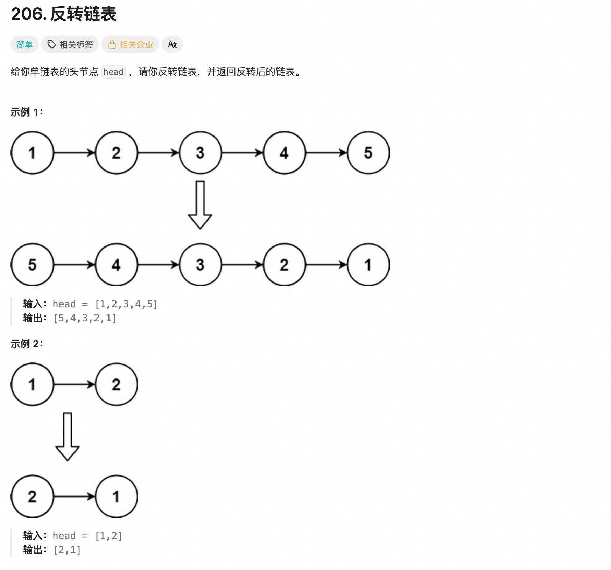

#### 1.1.2 递归搜索

##### 206、反转链表

[leetcode.cn/problems/longest-substring-without-repeating-characters/?utm_source=LCUS&amp;utm_medium=ip_redirect&amp;utm_campaign=transfer2china](https://leetcode.cn/problems/longest-substring-without-repeating-characters/?utm_source=LCUS&utm_medium=ip_redirect&utm_campaign=transfer2china)


```Python
class Solution:
    def lengthOfLongestSubstring(self, s: str) -> int:
        freq = {}
        right = 0
        left = 0
        best = 0
        # for i in range(len(s)):
        #     freq[s[i]] = freq.get(s[i],0) + 1
        #     # print(s[i], ":", freq[s[i]])
        for right in range(len(s)):
            ch = s[right]
            freq[ch] = freq.get(ch, 0) + 1
            while(freq[ch] > 1):
                pop_ch = s[left]
                freq[pop_ch] = freq[pop_ch] - 1
                left += 1
                # print("left:",left)
                # print("right:",right)
                # print("best:", best)
            best = max(best, right - left + 1)
        return best
      
```

##### 104、二叉树最大深度

[leetcode.cn/problems/maximum-depth-of-binary-tree](https://leetcode.cn/problems/maximum-depth-of-binary-tree/)




```python
# Definition for a binary tree node.
# class TreeNode:
#     def __init__(self, val=0, left=None, right=None):
#         self.val = val
#         self.left = left
#         self.right = right
class Solution:
    def maxDepth(self, root: TreeNode | None) -> int:
        res1 = 1
        res2 = 1
        if (root is None): return 0
        if (root.left is not None):
            res1 = self.maxDepth(root.left) + 1
        if (root.right is not None):
            res2 = self.maxDepth(root.right) + 1
      
        return max(res1, res2)
```


3、最长无重复子串

##### 3、最长无重复子串
