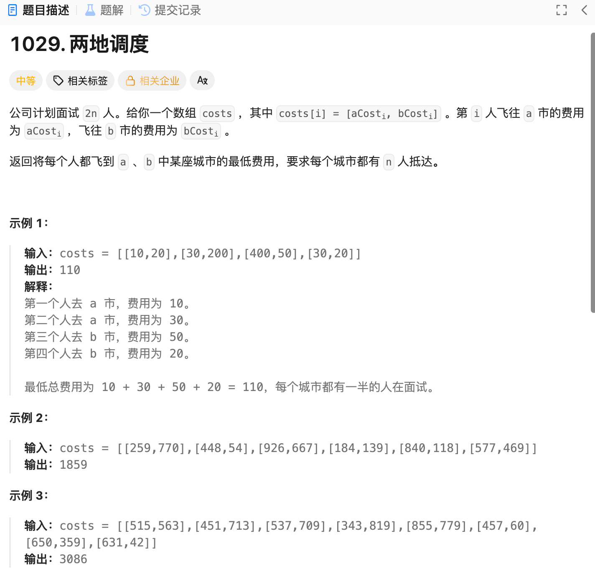
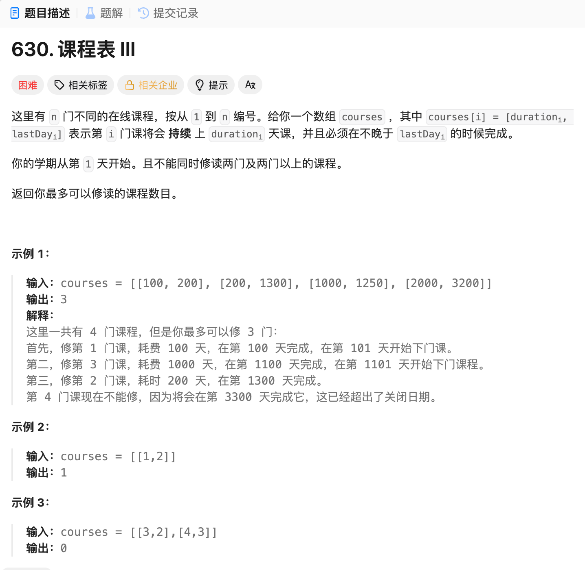

#### 1.1.3 排序贪心

##### 3、两地调度



```Python
class Solution:
    def twoCitySchedCost(self, costs: list[list[int]]) -> int:
        def cost_diff(cost):
            return cost[0] - cost[1]
        costs_sort = sorted(costs, key=cost_diff)
        print(costs_sort)
        res = 0
        for i in range(len(costs_sort)):
            if i < len(costs_sort) / 2:
                res += costs_sort[i][0]
                print("i:",i)
                print("value:", costs_sort[i][0])
            else :
                res += costs_sort[i][1]
                print("i:",i)
                print("value:", costs_sort[i][1])
        return res
```


##### 630、课程表 III




```Python
class Solution:
    import heapq
    def scheduleCourse(self, courses: List[List[int]]) -> int:
        # 1 按deadline 排序
        # 2 一次加入课程
        # 3.反悔贪心 
        #   如果超了deadline, 回溯课程 删除最长耗时课程 （小顶堆 模拟 大顶堆）
        #   如果没超deadline, 继续加入下一个课程
        heap = []
        cost_day = 0
        # heapq.heappush(heap, -100)
        # heapq.heappush(heap, -200)
        # heapq.heappush(heap, -1000)

        # print("see max:", -heap[0])

        # maxValue = -heapq.heappop(heap)
        # print("out max:",maxValue)

        def getLastDay(x):
            return x[1]
        courses.sort(key=getLastDay)
        print(courses)

        for i in range(len(courses)):
            if (courses[i][0] > courses[i][1]):
                continue
            # 可以加入课程
            if (courses[i][0] + cost_day <= courses[i][1]):  
                cost_day += courses[i][0]
                heapq.heappush(heap, -courses[i][0])
            else:
                heapq.heappush(heap, -courses[i][0])
                max_duration = -heapq.heappop(heap)
                use_duration = min(courses[i][0], max_duration)
                cost_day += use_duration

        return len(heap)

```
