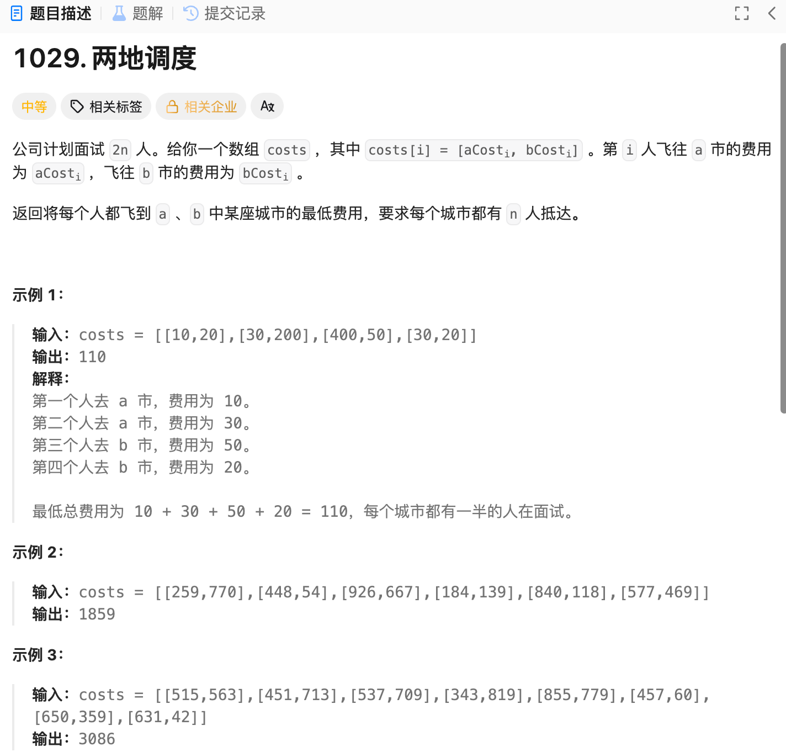

#### 1.1.3 排序贪心

##### 3、两地调度



```Python
class Solution:
    def twoCitySchedCost(self, costs: list[list[int]]) -> int:
        def cost_diff(cost):
            return cost[0] - cost[1]
        costs_sort = sorted(costs, key=cost_diff)
        print(costs_sort)
        res = 0
        for i in range(len(costs_sort)):
            if i < len(costs_sort) / 2:
                res += costs_sort[i][0]
                print("i:",i)
                print("value:", costs_sort[i][0])
            else :
                res += costs_sort[i][1]
                print("i:",i)
                print("value:", costs_sort[i][1])
        return res
        
```

##### 3、最长

##### 3、
