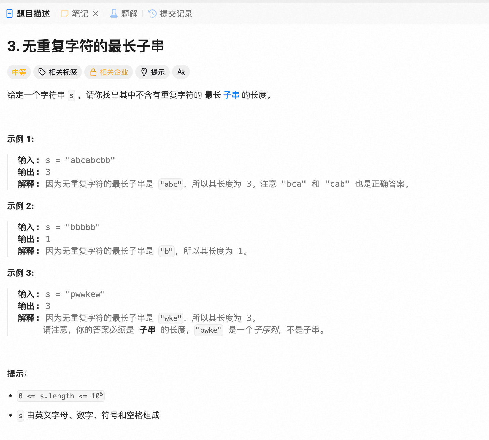

#### 1.1.4 序列优化




##### 3、最长无重复子串

```Python
class Solution:
    def lengthOfLongestSubstring(self, s: str) -> int:
        freq = {}
        right = 0
        left = 0
        best = 0
        # for i in range(len(s)):
        #     freq[s[i]] = freq.get(s[i],0) + 1
        #     # print(s[i], ":", freq[s[i]])

        for right in range(len(s)):
            ch = s[right]
            freq[ch] = freq.get(ch, 0) + 1

            while(freq[ch] > 1):
                pop_ch = s[left]
                freq[pop_ch] = freq[pop_ch] - 1
                left += 1
                # print("left:",left)
                # print("right:",right)
                # print("best:", best)
            best = max(best, right - left + 1)
        return best
```


##### 3、最长无重复子串


##### 3、最长无重复子串

##### 3、最长无重复子串

