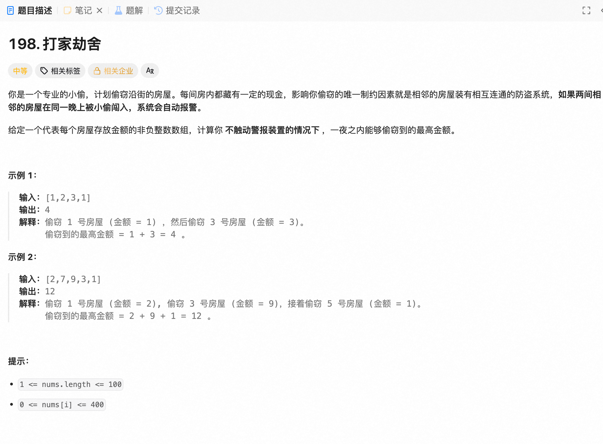

#### 1.1.5 动态规划

##### 198、打家劫舍



[leetcode.cn/problems/house-robber](https://leetcode.cn/problems/house-robber/)

```Python
class Solution:
    def rob(self, nums: List[int]) -> int:
        n = len(nums)
        values = [ 0 * row for row in nums]
        if n == 0 : return 0
        if n == 1 : return nums[n-1] 
        if n == 2 : return max(nums[n-1], nums[n-2])
        if n > 2 :
            for i in range(n):
                if i == 0: values[i] = nums[0]
                elif i == 1: values[i] = max(nums[0], nums[1])
                elif i > 1 :
                    values[i] = max(values[i-2] + nums[i], values[i-1])
        return values[n-1]
```
