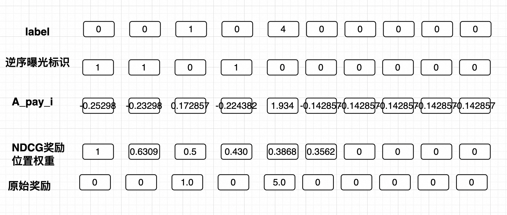

#### 2.1.1 Full-domain RL

##### 2.1、项目背景

搜索重排模型负责对精排后的候选商品进行列表级建模和二次排序。在搜索场景下，重排模型通常会对top50个候选商品打分，并通过贪心算法选取 top10 商品进行曝光。传统重排模型的优化目标主要围绕曝光域内的点击和下单展开，即只关注进入 top10 的商品是否被点击、成交。

在实际业务中，非搜域的成交行为发生在搜索未曝光的商品（候选的top11-top50商品中）上，这些“重排未曝光但全域成交”的样本，蕴含了模型对用户需求的真实反馈。因此，引入未曝光的重排全域成交样本，就能有效提升搜索请求下的全域成交指标。业界对于topN商品的序列整体价值，通常使用下单hitrate和GMV_ndcg指标进行评估。

因此，项目的核心目标是：在搜索重排中引入搜索未曝光的全域下单样本，提升重排模型对全域成交的排序能力。预期通过优化全域下单 hitrate** **和** **GMV-NDCG** **等离线指标，最终带动大盘的 GMV 和 Order 增长。

* 为了进一步理解搜索重排模型对全域成交排序能力，需要将全域模型建模目标，拆解成下面2个子任务：
  * 1. 保障搜索域排序AUC指标持平：在新模型中，搜索域正样本（search_pay 下图黑色线）与搜索域负样本（search_pv_not_pay 下图紫色线）的相对序关系应保持不变，搜索域 AUC 至少持平。
  * 2. 提升全域下单 hitrate指标：非搜索域成交样本（not_search_pay 下图红色线）的打分应尽可能高于搜索域负样本（search_pv_not_pay 下图紫色线），但低于搜索域正样本（search_pay 下图黑色线），从而在不破坏搜索域排序的前提下，提升全域成交商品的下单 hitrate** **和** **GMV-NDCG** **指标。

    * 

    * 

#### 2.2、全域建模离线优化

* 搜索域样本和非搜域样本融合建模方案
  * 重排基线：

    * 方案：未利用全域成交样本，模型对全域成交潜力商品缺乏排序能力，仅使用搜索域样本训练。
    * 离线指标：（rank_pvp=0.9179，rerank_pvp=0.9243，hitrate1=0.2651，hitrate10=0.6082）
  * (1) 引入非搜全域label：

    * 方案：将 label 扩展为 rec_pay + search_pay，并采用 (1-w1)*sea_pre + w1*rec_pay 的融合方式，让模型同时拟合搜索域和推荐域成交信号。
    * 离线指标：rerank_pvp 下降 -0.0030，hitrate10 下降 -0.1203，搜索域和全域指标双降。
    * 遇到问题：直接混合不同域的成交 label，会导致模型对搜索域样本的拟合被非搜域样本干扰，破坏了搜索域正负样本的序关系；同时，非搜域样本与搜索域特征分布差异大，直接引入带来负迁移。
  * (2) 分层域样本 loss 权重：

    * 方案：在引入非搜域 label 的基础上，为搜索域成交、推荐域成交和其他样本设置不同的 loss 权重 。目的是通过增强搜索域样本权重，来缓解域间样本负迁移问题。
    * 离线指标：rerank_pvp 仍下降 -0.0012，hitrate10 仍下降 -0.0317，虽然相比直接引入 label 有所改善，但搜索域和全域仍未同时正向。
    * 遇到问题：单纯调整样本权重只能在 loss 层面缓解冲突，无法从根本上解决搜索域和非搜域目标不一致的问题；loss权重的超参数高度敏感，单独2个超参数很难平衡搜索域和非搜域的排序分布。
  * (3) Pairwise Loss ：

    * 方案：引入 Pairwise Loss，显式建模候选商品不同成交域的商品对之间的相对序关系，希望通过对排序对的约束，实现搜索域排序能力保持和全域hitrate指标提升的双重目标。
    * 离线指标：rerank_pvp 下降 -0.0009，hitrate1 持平（0.0157）,hitrate10 持平（0.0000）。
    * 遇到问题：Pairwise Loss 缓解了部分负向影响，但全域 hitrate 没有提升，说明仅依赖相对序约束不足以激活非搜域成交样本的排序信号。
  * (4) GRPO Loss ：
  * 
  * 
  * 
  * * 方案：采用 GRPO（Group Relative Policy Optimization）强化学习方法，通过组内相对优势估计来优化排序策略， 通过同请求下个性化奖励，平衡搜索域和非搜域的排序分布的目标。
    * 离线指标：rerank_pvp 下降 -0.0016，但 hitrate10 提升** **+0.0656。
    * 遇到问题：** **GRPO模型能够以牺牲搜索域部分排序能力，换取全域下单收益，但两个目标仍未同时达到最优，存在“跷跷板效应”。

* * (5) SAPO Loss ：

    * 
    * 
    * 方案：采用 SAPO（Self-Adaptive Preference Optimization）Loss，在 GRPO 基础上引入 KL 约束和自适应偏好优化，试图在搜索域和非搜域之间取得更好平衡。
    * 离线指标：rerank_pvp 下降 -0.0012，hitrate10 大幅提升** **+0.1233。
    * 遇到问题：SAPO 显著提升了全域 hitrate离线指标，但搜索域 rerank_pvp 仍未转正。全域收益的提升仍然以搜索域 AUC 的一定损失为代价，尚未实现“搜索域持平”的硬约束。
  * 
  * (6) SAPO Loss + Listwise 奖励优化：

    * 方案：在 SAPO Loss 基础上，引入基于 NDCG 的 Listwise 位置奖励和逆序对曝光惩罚。
      * 基于NDCG位置奖励（借鉴listwise方法）：** **r_\text{pay_j} = \frac{pay_j}{\log_2(j+1)}** **，成交商品排在越靠前位置，奖励越高。
      * 
      * 
      * 逆序对曝光奖励惩罚（借鉴listwise方法）：惩罚未成交商品排在成交商品前面的曝光商品。

        * r_j = w1 * r_\text{pay_i} + w2* r_{\text{pair,nonpay},j}** **
        * r_{\text{pair,nonpay},j} = \begin{cases} \displaystyle \sum_{i \in \text{pay}, i>j} \text{pair\_soft}_{ij} & \text{if } \text{nonpay}_j=1 \text{ and num\_pay}_j>0 \\ 0 & \text{otherwise} \end{cases}
        * \text{pair\_soft}_{ij} = \sigma\big(\gamma * (rerank_{pvp_i} - rerank_{pvp_j})\big)
          * i∈pay, i>j： 商品i成交，商品j在i之前，j商品未成交。
          * \text{pair\_soft}_{ij}** **：计算商品j的惩罚奖励，成交商品i优化非成交商品j的概率。
      * 离线指标：

        * rerank_pvp 提升** **+0.0004，搜索域 AUC 首次转正；
        * hitrate10 提升** **+0.1087（相较基线），hitrate1 稳定提升** **+2pt+；
      * 遇到问题：非搜域收益向全域收益的传导效率偏低，线上指标难撬动。
  * 
  * 多种优化方案离线指标对比：
  * 

  | 模型版本                                                                           | 核心修改                     | rank_pvp | rerank_pvp | hitrate1 | hitrate10 | rerank_pvp_uplift | hitrate10_uplift |
  | ---------------------------------------------------------------------------------- | ---------------------------- | -------- | ---------- | -------- | --------- | ----------------- | ---------------- |
  | 基线                                                                               | 重排基线                     | 0.9179   | 0.9243     | 0.2651   | 0.6082    | 0.0               | 0.0              |
  | 引入非搜全域label* pvp_labels=rec_pay+search_pay* (1-w1)sea_pre+w1rec_pay          | 0.9179                       | 0.9213   | 0.2084     | 0.4879   | -0.0030   | -0.1203           |                  |
  | 分层域样本loss权重* pvp_labels=rec_pay+search_pay* w_search_pay/w_rec_pay/w_others | 0.9179                       | 0.9231   | 0.2182     | 0.5765   | -0.0012   | -0.0317           |                  |
  | Pairwise Loss                                                                      | 0.9179                       | 0.9234   | 0.2808     | 0.6082   | -0.0009   | 0.0               |                  |
  | 优化1                                                                              | Grpo Loss                    | 0.9179   | 0.9227][   | 0.2753   | 0.6637    | -0.0016           | 0.0656           |
  | 优化2                                                                              | SAPO Loss                    | 0.9179   | 0.9231     | 0.3042   | 0.7315    | -0.0012           | 0.1233           |
  | 优化3                                                                              | SAPO Loss + listwise奖励优化 | 0.9179   | 0.9247     | 0.2961   | 0.7169    | +0.0004           | 0.1087           |
  | ---                                                                                | ---                          | ---      | ---        | ---      | ---       | ---               | ---              |
  |                                                                                    |                              |          |            |          |           |                   |                  |

* AUC离线指标监控：对于线上基线，rerank_pvp_auc涨+0.04pt（0521开始，蓝色线高于橙色线）。

  * 
* 全域下单hitrate1离线指标监控：稳定涨+2pt+。

#### 2.3、全域建模在线实验

* 在线pcoc指标校准

  * sapo模型+pcoc合页损失（打压高估样本）
    * \begin{align} L_{\text{SAPO}}(\theta) &= -\mathbb{E}\left[\frac{1}{G}\sum_{i=1}^{G} \frac{\pi_\theta(o_i|q)}{\pi_{\theta_{\text{old}}}(o_i|q)} A_i \cdot \tau(A_i) \right] + \beta D_{\text{KL}}(\pi_\theta \parallel \pi_{\text{ref}}) \\ + \alpha * pcoc_\text{loss} \end{align} \\ pcoc_\text{loss} = (max((\text{rerank_pvp}_\text{pred} - \text{rerank_pvp}_\text{label}),0.0))
    * pcoc在线指标：(27桶实验桶 ｜34桶基准桶)
      * 
* 全域模型实验：

  * 搜索流量指标：六国 20%流量 3天（0418～0420） GMV** **0.35%** **Order** **0.24%
  * 
  * 搜索域流量指标拆解：
    * 搜索域流量下单Order = 搜索域内立即下单Order + 非搜域下单Order
      * 通过Apollo看板可以统计，当前搜索域流量下单渠道在搜索域还是非搜域。看板统计非搜域下单Order只占大盘18.3%（11938/65203=18.3%）。非搜域渠道下单Order上涨1.56%** **对全域渠道下单Order提升幅度小0.28%。
      * 

##### 1.4、全域建模项目难点

* 非搜域收益向全域收益的传导效率偏低

  * 搜索流量的非搜域渠道下单Order上涨1.56%** **对全域渠道下单Order提升幅度小0.28%。由于非搜域下单占比是18.3%，导致非搜域提升在全域口径下收益明显稀释。
* 全域提分对搜索域校准产生跨域扰动

  * 全域模型预估的模型流量分提升后，搜索样本的 PCOC 偏大，且高于基线桶。当请求同时包含全域内容时，分数变化会影响搜索样本的预估与校准表现。

    * 
  * 目前解决方法是：纠偏需要抑制搜索样本的 PCOC 高估，同时不能破坏全域模型已取得的模型hitrate指标提升。sapo模型+pcoc合页损失（打压高估样本）

    * \begin{align} L_{\text{SAPO}}(\theta) &= -\mathbb{E}\left[\frac{1}{G}\sum_{i=1}^{G} \frac{\pi_\theta(o_i|q)}{\pi_{\theta_{\text{old}}}(o_i|q)} A_i \cdot \tau(A_i) \right] + \beta D_{\text{KL}}(\pi_\theta \parallel \pi_{\text{ref}}) \\ + \alpha * pcoc_\text{loss} \end{align} \\ pcoc_\text{loss} = (max((\text{rerank_pvp}_\text{pred} - \text{rerank_pvp}_\text{label}),0.0))
