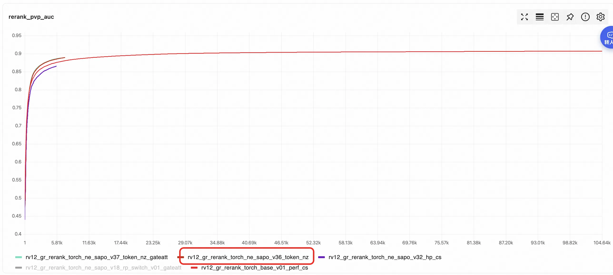
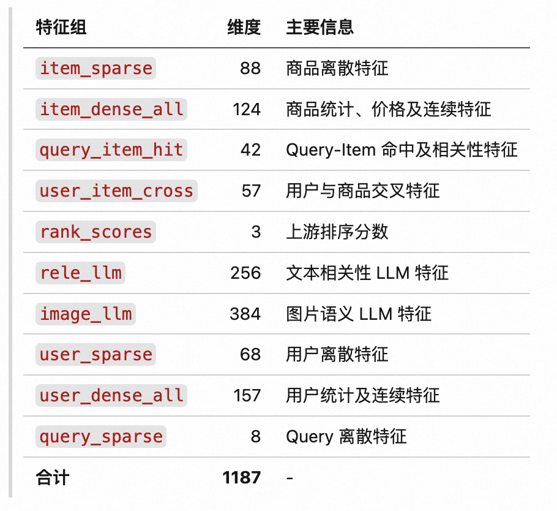
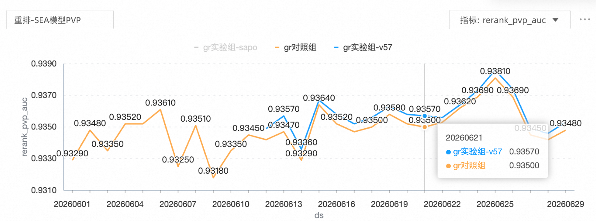

#### 2.2.1-01 理论部分

##### 2.1、理论部分

##### （1）背景与核心定义

电商排序场景的特征天然异构：包含离散ID（用户/商品ID、类目、品牌）、连续数值（价格、点击率、GMV）、时序行为序列（点击/加购/购买历史）、多模态预训练向量（文本相关性、图像特征）等，它们维度不同、结构不同、语义空间完全独立。

异构特征 Tokenization 是 Transformer 落地推荐排序的前置核心模块。其定义为：

将不同类型、不同维度、不同语义的异构特征，通过编码、投影、分组、序列化等方式，转换为统一维度、语义可区分、可直接输入 Transformer 的 Feature Token 序列，让注意力机制能够平等地对所有特征做细粒度交互建模。

##### （2）核心设计目标

+ 维度一致性：所有 Token 最终映射到同一隐层维度（hidden_dim），满足 Transformer 注意力计算的输入要求。
+ 语义保留性：保留原始特征的业务语义与区分度，避免归一化、投影操作导致的信息损失（尤其稀疏特征的能量梯度）。
+ 计算可控性：控制 Token 总数，将自注意力的二次复杂度约束在可接受的推理时延内。
+ 梯度完整性：保障稀疏 Embedding 的模长/能量梯度可反向传播，避免归一化层阉割 scale 学习信号。

##### （3）主流技术范式（对应电商排序场景）

**（3-01）离散特征：ID Embedding → 单 Token**

最基础的范式：每个离散特征字段（性别、类目、品牌）的 ID 值，通过 Embedding 查表得到向量，直接作为一个独立 Token。

+ 适用场景：低基数离散特征、稀疏 ID 特征
+ 局限：高基数特征 Embedding 参数量大；单特征对应一个 Token 会导致 Token 总数爆炸，算力不可控

**（3-02）连续特征：数值编码 → 投影 → Token**

主流有两种实现路线：

1. 分桶离散化：将价格、年龄等连续值按分位数/等宽分桶，转为离散 ID 后做 Embedding，和离散特征处理逻辑一致。
2. 直接线性投影：每个连续特征通过独立的线性层，直接映射到 hidden_dim 维度，作为一个 Token（FT-Transformer 的标准方案）。

+ 核心要点：尽量保留数值的大小关系，避免粗粒度分桶丢失细粒度区分度。

**<font style="color:#DF2A3F;">（3-03）分组特征 Token（实验采用方法）</font>**

+ 思路：按语义将特征划分为若干组（如商品属性组、用户属性组、交叉特征组、LLM向量组），同组内特征先拼接，再通过独立 MLP 投影为 1 个（或少量）Token。
+ 核心优势：

  1. 大幅压缩 Token 数量（从上百个特征压缩到 10 个以内），将注意力算力控制在可接受范围；
  2. 同语义特征在组内先做局部交互，减少跨语义噪声，提升注意力效率。
+ 代表工作：RankMixer、Group Transformer，以及你当前的精排架构。

#### 2.2.1-02 实验部分



       在Transformer的基座排序模型上，所有特征都Tokenization到256维度，最后的AUC在6k步，训练AUC就会有明显提升，提升从0.876-->0.886，提升了1.0pt+。

##### 2.2、异构特征 Tokenization

基线模型将全部输入特征直接拼接并压缩到 256 维。模型将原有的 1187 维异构特征输入按业务语义拆分为 10 个异构特征组：



得到 10 个统一维度的语义 Token 后，再拼接为 2560 维，通过 Linear(2560, 256) 完成组间融合，送入后续 Decoder。

该方案的主要收益包括：

+ （1）明确 用户、商品、Query、交叉、精排分和向量特征的语义边界。
+ （2）将组内表征和组间交互拆分建模，降低异构特征相互干扰。
+ （3）为后续扩展特征组、分析特征贡献和进行组级消融提供结构化接口。

##### 2.3、GroupEnergyNorm 组能量归一化

针对不同特征组的输入分布存在明显的差异，为每个业务特征组维护独立的token RMS 统计，并通过可学习 Scale 调整组能量：

```plain
GroupEnergyNorm -> Linear(d_group, 256) -> SiLU
```

y_g = x_g / (EMA_{RMS_{g}} + epsilon) * scale_g

+ <font style="color:rgb(0, 0, 0);">scale_g </font>: 为可学习缩放参数。
+ EMA_RMS_g: 特征组取值的RMS统计。

该模块在输入投影前完成细粒度的尺度适配，使模型更关注特征内容和有效交叉关系，减少稀疏特征的梯度受高维特征主导影响的问题。

##### 2.4、Self-Gated Multi-Head Attention

在 PV Causal Decoder 中引入三类门控：

+ **X-Gate：**在 QKV 投影前进行表示级特征选择，降低噪声维度对后续交互的影响。
+ **Q-Gate：**控制当前候选商品的自适应查询强度，使不同候选能够使用不同的查询表达。
+ **K-Gate：**控制历史候选商品的交互强度，减轻无关或高能量 Token 对注意力分配的干扰。

g_Q = \sigma(X W_{gQ} + b_{gQ}) \\ g_K = \sigma(X W_{gK} + b_{gK}) \\ g_X = \sigma(X W_{gX} + b_{gX})

##### 2.5、实验效果

+ 离线效果：

在六国全量样本上进行 60d+ 训练，对比 60 天冷启动基线和训练数据超过 6 个月的线上模型：



**离线收益主要来自两方面：**(1) 异构特征按业务语义 Token 化，并通过组级能量归一化改善特征尺度；(2) 通过 X/Q/K 三层门控降低噪声交互，增强候选查询和历史候选信息的有效表达。

+ 在线效果：
  - 实验分层为 `<font style="background-color:rgba(0, 0, 0, 0.06);">lzd_se_rerank_exp_bid</font>`，实验桶为实验 6/7 桶平均与基准 0/1 桶平均，六国 20% 流量观察 14 天，周期为 2026年08月11日至2026年08月24日。
    * 合并实验效果（Tokenization + kvcache + 重排扩Pagesize）：
      + GMV <font style="color:rgb(223, 42, 63);">+1.62%</font> Order <font style="color:rgb(223, 42, 63);">+0.83%</font> PV <font style="color:rgb(223, 42, 63);">+0.16%</font>
    * 消融实验效果（Tokenization 单项实验）：
      + GMV <font style="color:rgb(223, 42, 63);">+1.23%</font> Order <font style="color:rgb(223, 42, 63);">+0.49%</font> PV <font style="color:rgb(223, 42, 63);">+0.34%</font>
