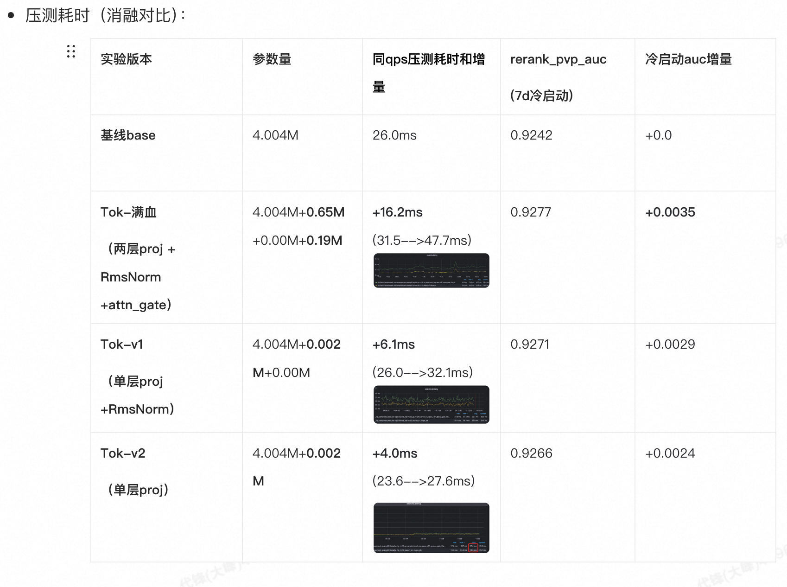

#### 2.2.3-01 实验部分
##### （1）对比自回归循环次数，模块增量测试耗时。

#### 2.2.3-02 理论部分
##### （1）减少Kernel启动次数
+ 问题： CUDA Kernel调用次数从154次增加到300次
    - 分析`group_proj`和`llm_attn_dnn_maps`的前向传播，合并多个小的矩阵乘法
    - 使用Torch的融合操作（如`torch.nn.functional.linear`）替代手动的矩阵乘法+bias
    - 考虑使用`torch.jit.script`或`torch.compile`进行算子融合

##### （2）优化Attention Pooling实现
+ 问题： `target_to_seq_attention_pool`新增显著开销
    - 序列运算，对于候选序列长度100进行计算 会带来显著的耗时开销，每个商品emb是128维。
