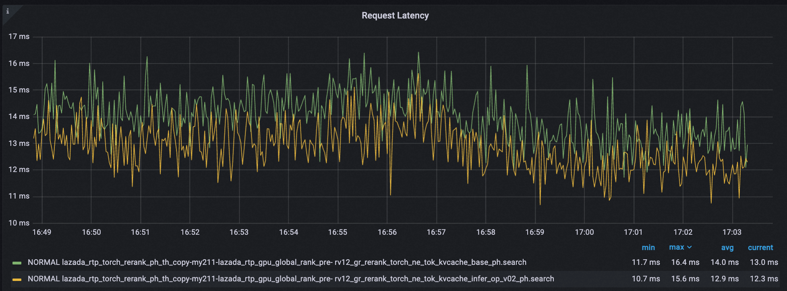
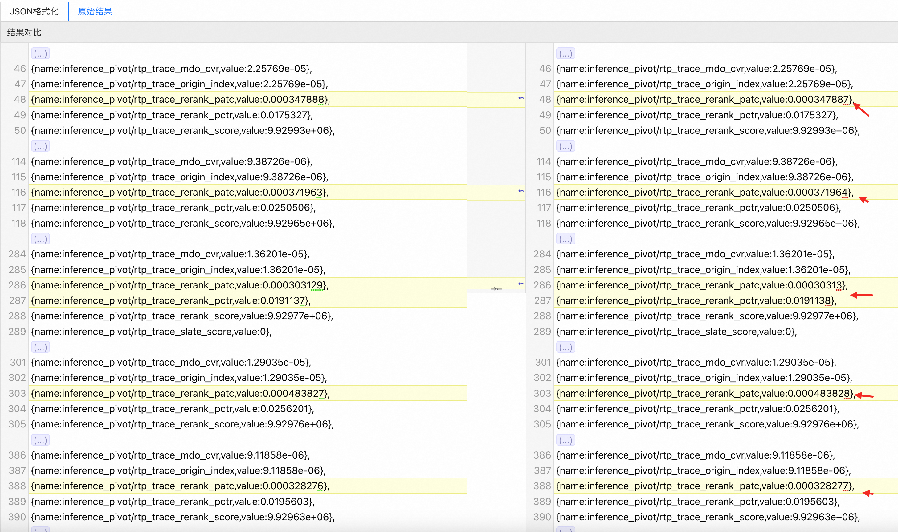
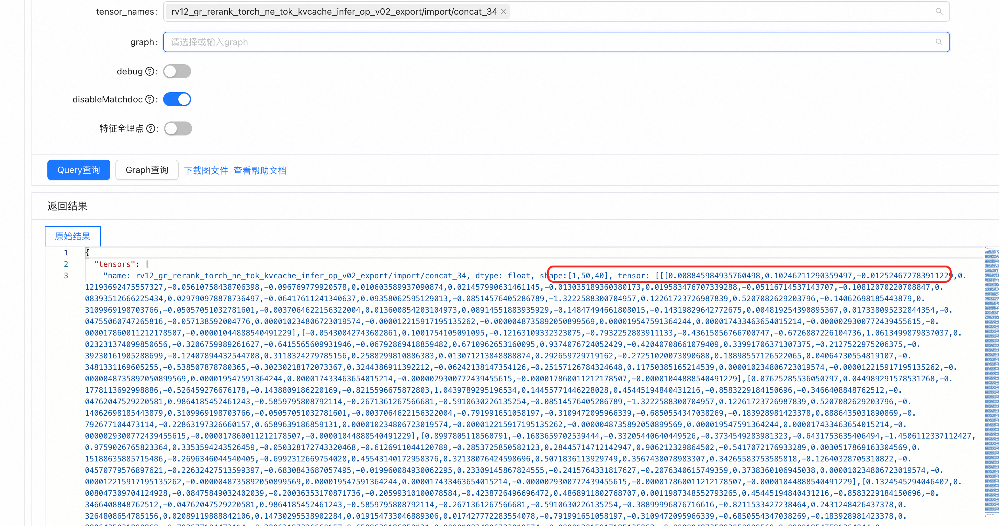
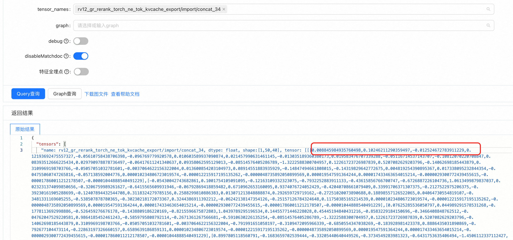
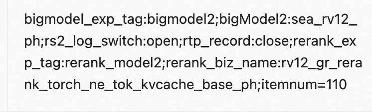

#### 2.2.3-01 模型删减模块优化

##### （1）对比自回归循环次数，模块增量测试耗时。

#### 2.2.3-02 模型删减模块优化

##### （1）减少Kernel启动次数

+ 问题： CUDA Kernel调用次数从154次增加到300次
  - 分析`group_proj`和`llm_attn_dnn_maps`的前向传播，合并多个小的矩阵乘法
  - 使用Torch的融合操作（如`torch.nn.functional.linear`）替代手动的矩阵乘法+bias
  - 考虑使用`torch.jit.script`或`torch.compile`进行算子融合

##### （2）优化Attention Pooling实现

+ 问题： `target_to_seq_attention_pool`新增显著开销
  - 序列运算，对于候选序列长度100进行计算 会带来显著的耗时开销，每个商品emb是128维。

#### 2.2.3-02 重排重复计算推理优化

* 1.1 推理侧优化（重排）** **耗时降低1.1ms，下降7.24%，
  * 动机：rv12重排推全实验KVcache能降1ms耗时，基于数据工程和模型微调方式上仍有推理耗时优化空间。
    * （1）** **紧凑输入和分组复用 + cudagraph：
      * 优化内容：

        * PV Causal Input Proj 内容复用** **（节省计算次数）

          * 内容256维+位置8维，将内容256维移到AR循环外计算一次，8个完整投影，修改后，成1次内容投影+8个位置投影。
        * 任务头首层合并（多个小矩阵乘 融合成 1个大矩阵乘）

          * 每轮 4个 259 --> 259 合并成 1个 259 --> 1036的宽 GEMM。8轮首层优化，GEMM Reduction SiLU从32次 降至8次。
        * CPU紧凑输入（序列重复商品先压缩后映射回）

          * 重复用户的查询 与 历史序列去重，先裁公共零尾部，再按完整序列去重。
        * Cuda Graph的算子融合和kernel调整
        * 耗时监控：

          
      * 打分对比：

        * 小数最后一位有些许差异，保证小数点后6位的差异。

          * （算子融合和kernel调整，会有精度上差异）

            
        * tensor名对比：

          

          
      * 核心配置：

        * 文档打分数需要固定：110，调候选大小，需要适配cuda_graph的配置。文档打分数<= cudagraph_padding_to** **		
