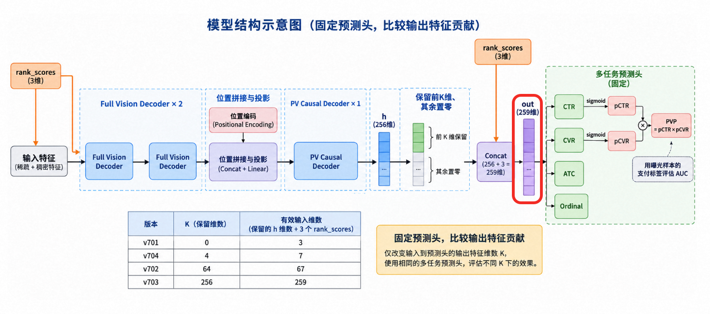
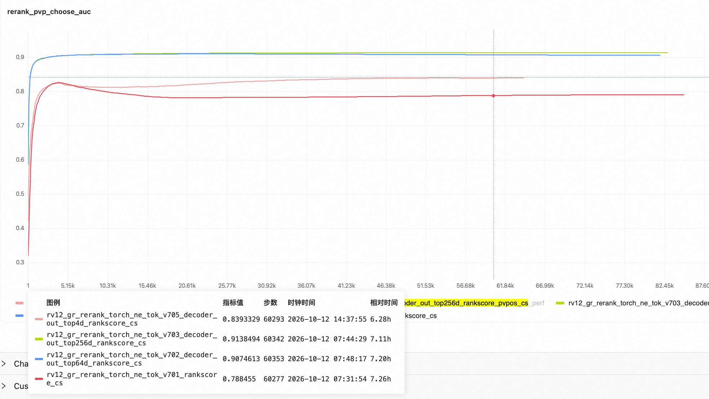

#### 2.2.4-01 实验部分

##### （1）对比分析不同模块的AUC贡献

decoder_out=[decoder的256维向量，rank_scores的三维]

- 对比了四组实验：

  - v701: out=[decoder的top0维向量，rank_scores的三维]
  - v702: out=[decodertop64维向量，rank_scores的三维]
  - v703: out=[decodertop256维向量，rank_scores的三维]
  - v705: out=[decodertop4维向量，rank_scores的三维]
- 实验方案：
  
- 对比效果：

  - v701 rankscores : 0.788
  - v702 top64d_rankscores : 0.907
  - v703 top256d_rankscores : 0.913
  - v705 top4d_rankscores : 0.839

    - 
