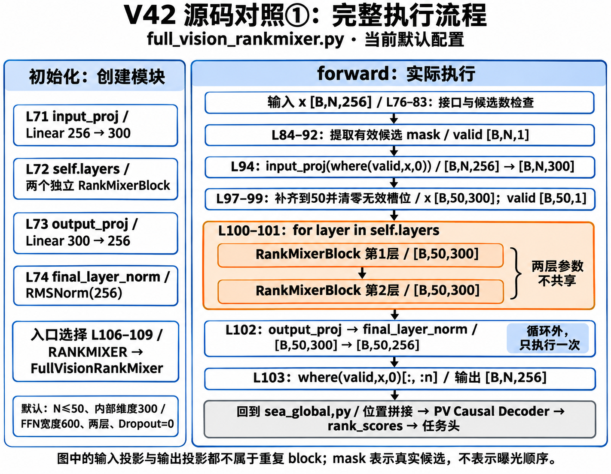
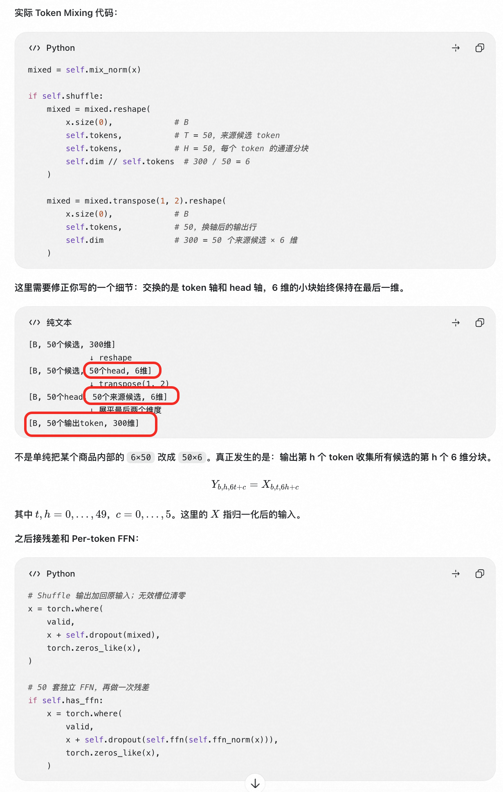
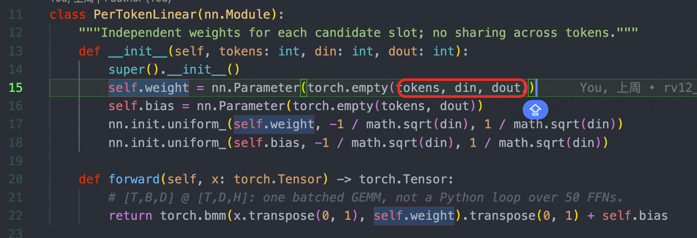
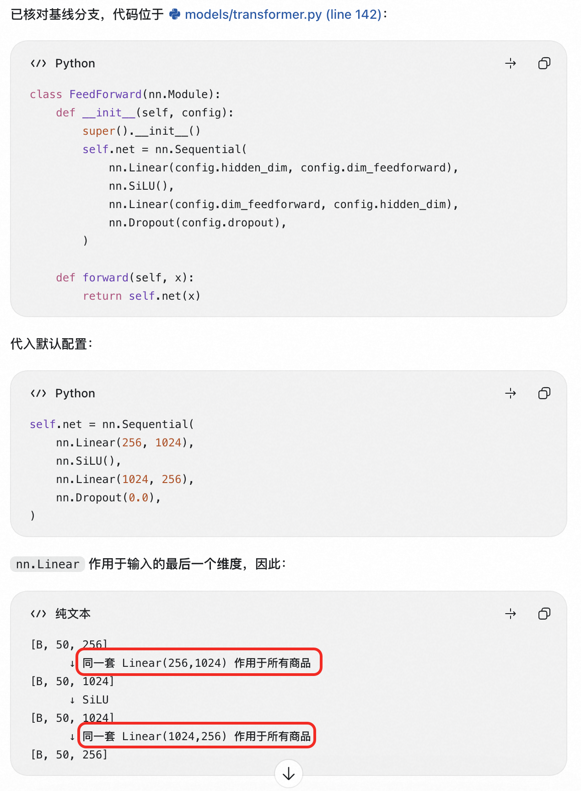
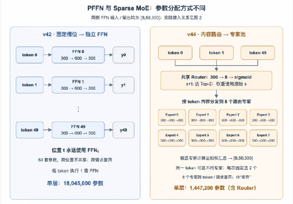

##### [3.1.1 RankMixer](<3.1.1%20RankMixer.html>)

#### 3.1.1-01 RankMixer

##### 3.1、TokenMixing

 代码逻辑图：

##### （1）多头token的混合

self-attention模块 替换成 多头的token mixing模块。每个token等分为多个head， 所有token的同一head拼接后，再映射会相同token数量。
  256-- 300
  300 -- 设置了50个head （N，50， 6 *50）
  300 -- 设置了50个head （N，50， 50 *6）
  reshape -- （N，50， 300）
  per-token-ffn -- 50 * (300-600-300)

##### 3.2、PerTokenFFN

- 每个token有独立的权重，引入独立的两层前馈网络的FFN，隔离不同token参数，有效增加了模型参数容量。
  - 
- 共享FFN
- 

##### 3.3、SparseMoe

SMoE主要解决的是推理耗时的问题， per-TokenFFN 会增加很多有效容量。从1* FFN参数 增加到 T ***  **FFN 的参数，SMoE主要解决是通过多个专家动态路由，例如 8 * FFN 近似得到 T*FFN的效果，全局共享专家FFN参数 和 动态路由FFN专家参数。
