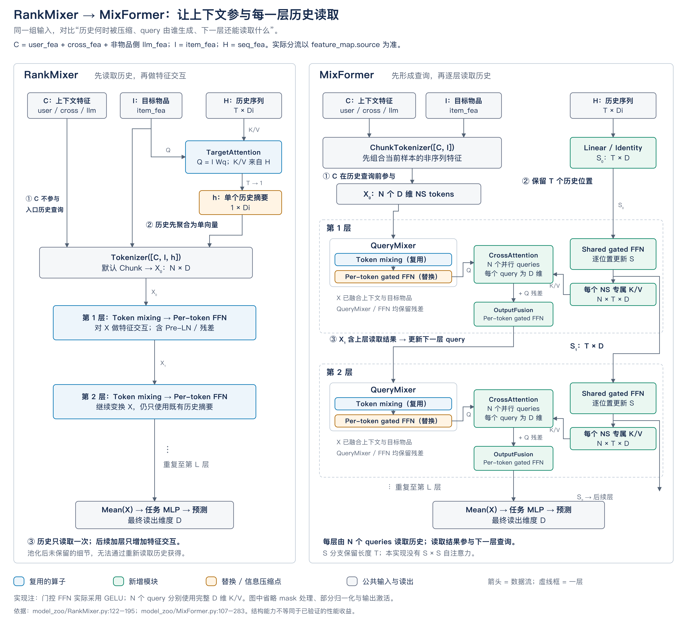
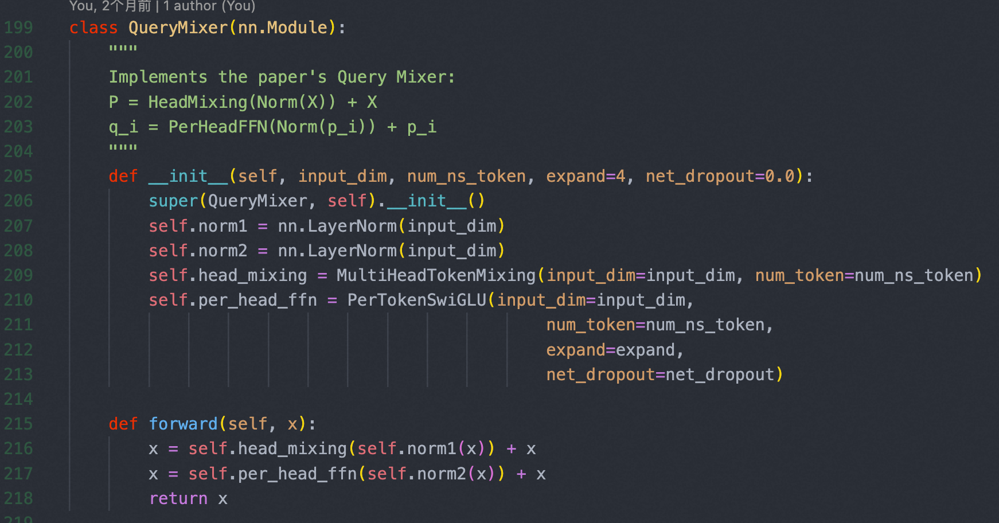
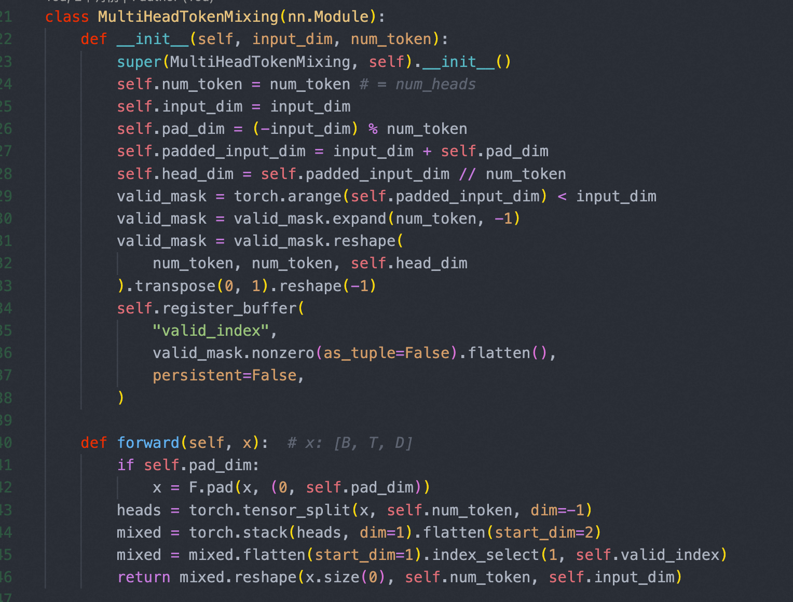
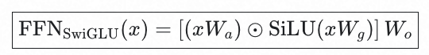
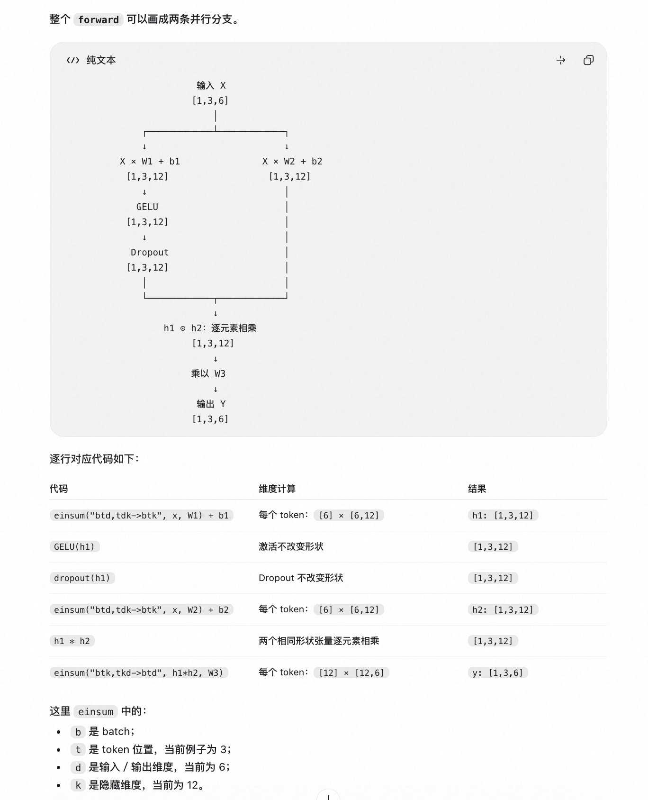
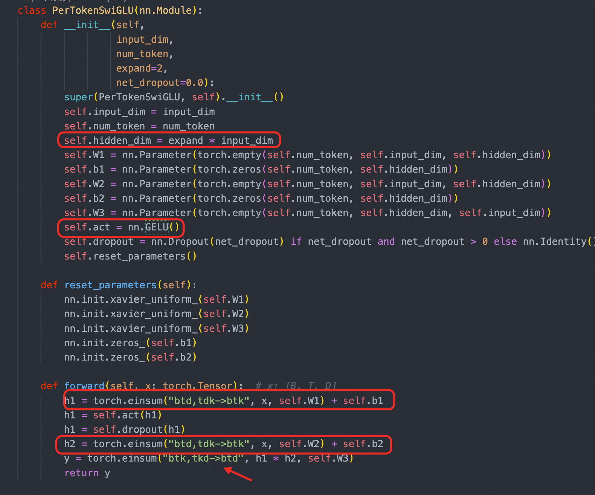
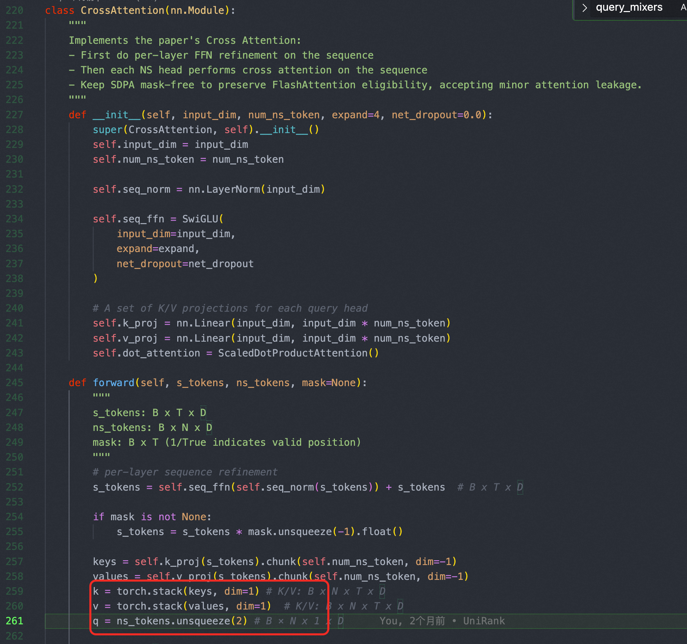
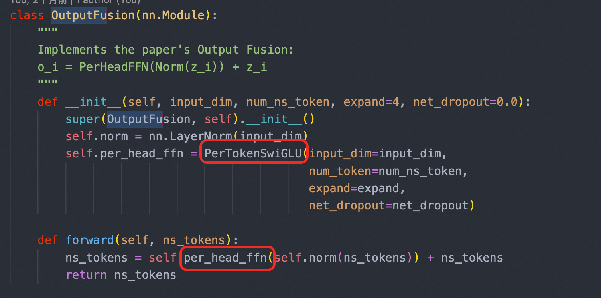

##### [3.2.1 MixFormer](<3.2.1%20MixFormer.html>)

#### 3.2.1 MixFormer

##### 3.1、QueryMixer

##### (1) MultiHeadTokenMixing

代码逻辑图：[ 1 3 6 ] --> [1 3 3 2 ] --> [1 3 6]

##### (2) PerTokenSwiGLU

##### 3.2、CrossAttention

- Query: B * N * 1 * D
- Key： B* N * T * D
- Value : B* *N * *T * *D

##### 3.3、OutputFusion

