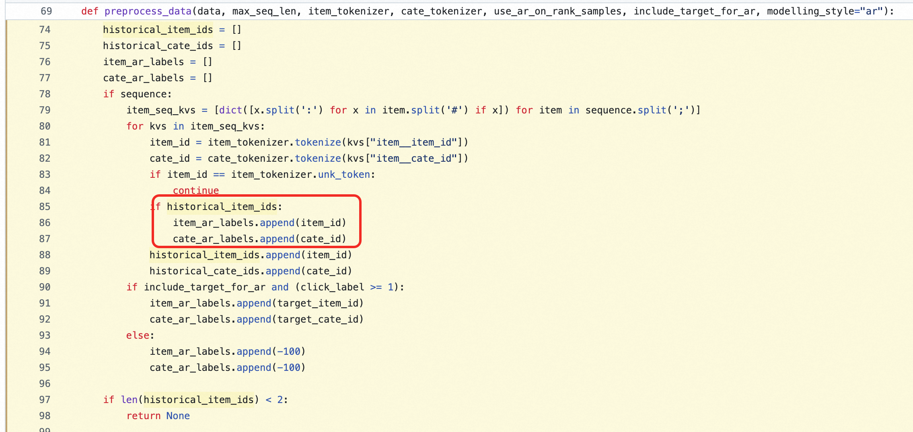
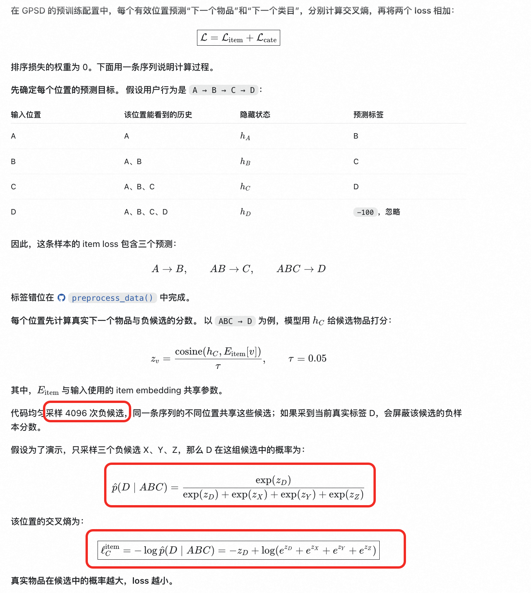
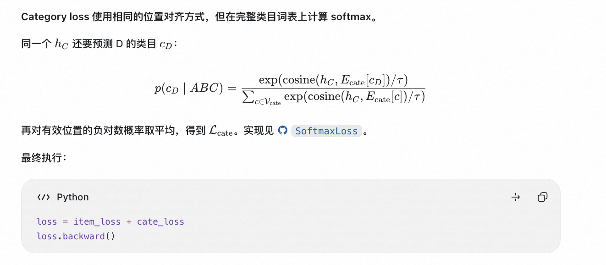
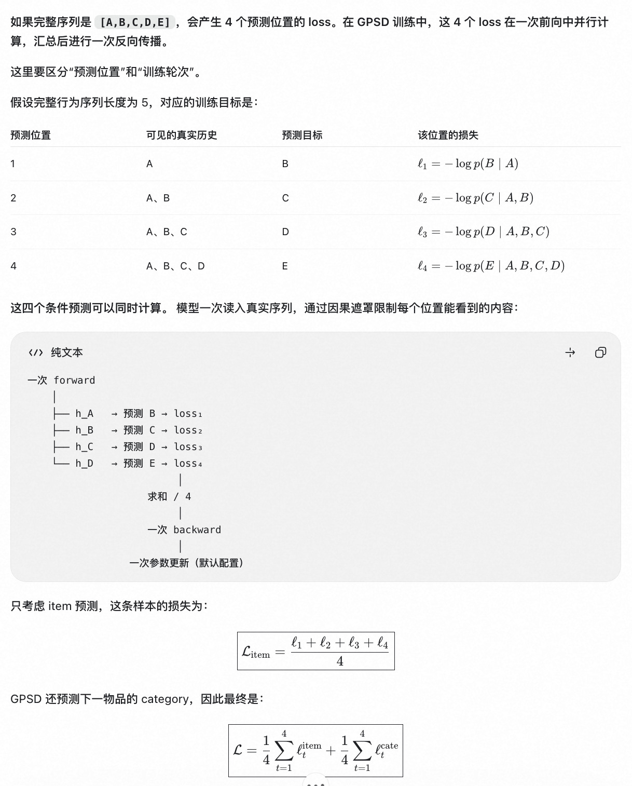

##### [4.1.1 GPSD](<4.1.1%20GPSD.html>)

##### 4.1、GPSD

- （1）样本组织。

  - 正样本：第一个物品加入输入，第二个物品非空，加入标签。
- - 最后一个商品跳出循环continue, item_ar_laels.append(-100)
- 

  - 负样本：
    - 
- （2）loss计算

  - 相当于采样负候选，通过正样本打分和标签的CEloss拟合，计算下一个商品预估概率。
  - loss = item_loss + cate_loss
  - loss.backward()
  - 
- （3）losss 计算轮数

  - loss均值求和，一次反向
  - 
-
