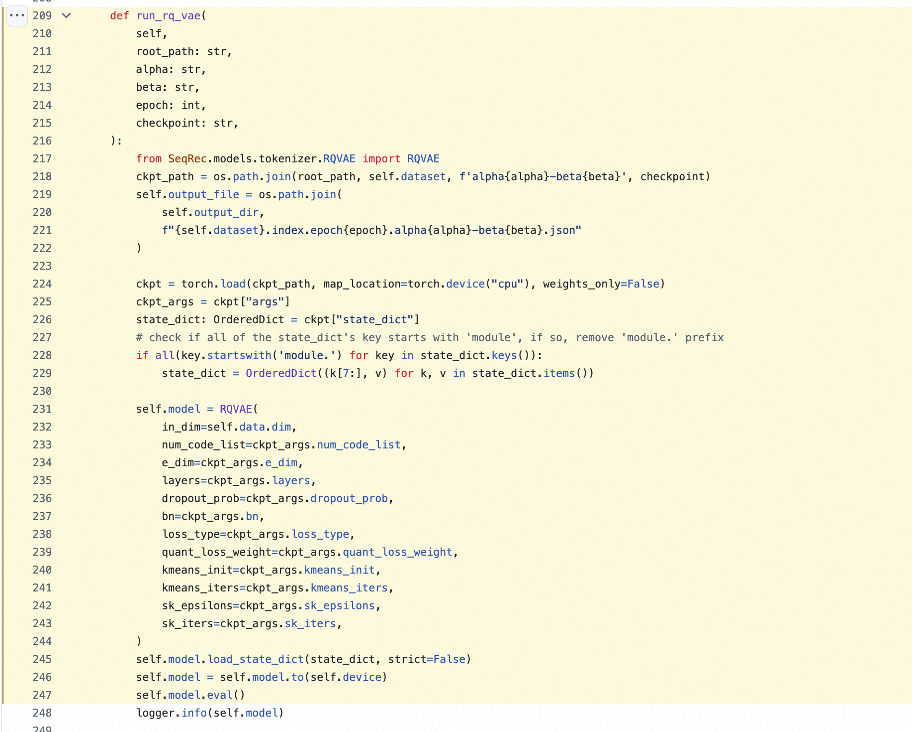
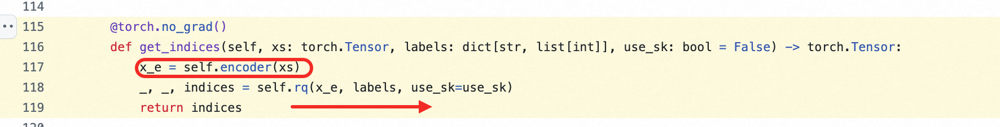
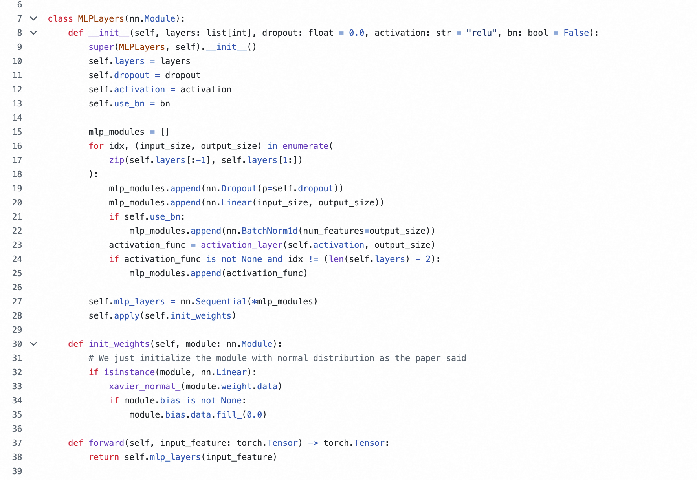
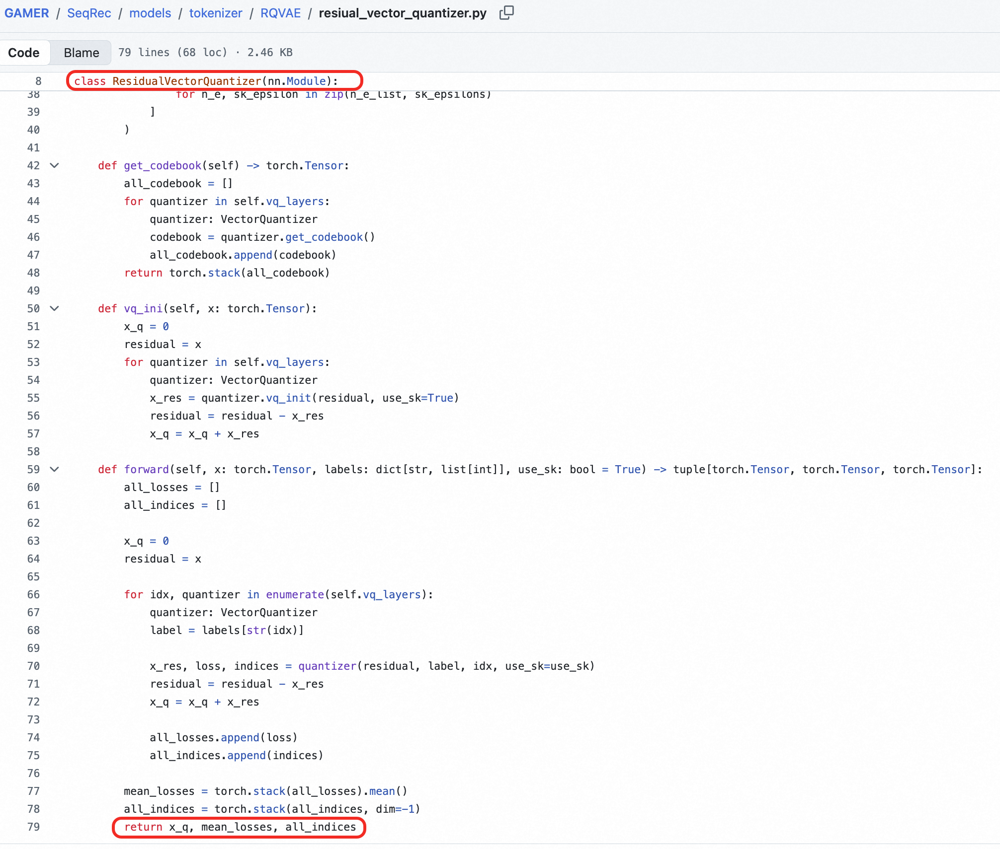
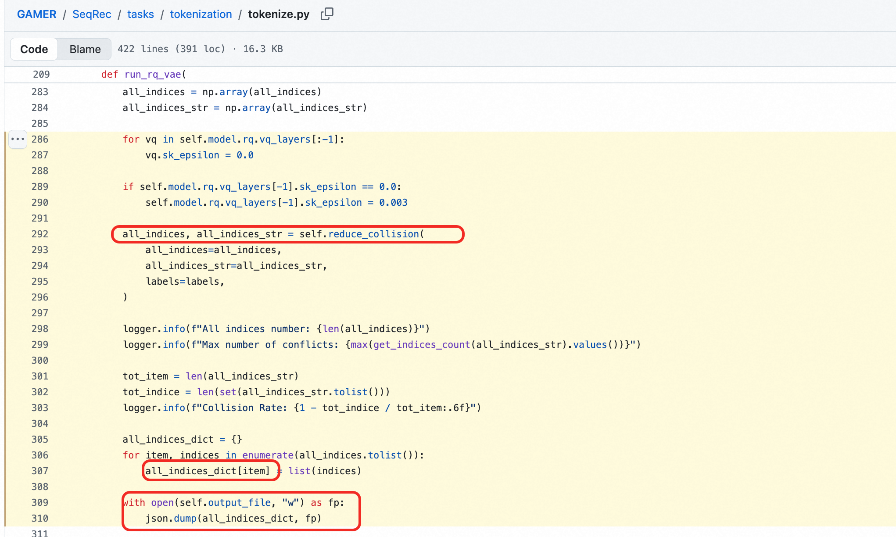

##### [4.2.1 GamerSID](<4.2.1%20GamerSID.html>)

##### 4.2、Gamer

- （1）启动SID生成任务

  ```Shell
  # scripts/tokenize.sh：28-37 行
        python main.py tokenize \
          --device cuda:${gpu} \
          --dataset ${dataset} \
          --data_path ${data_path} \
          --output_dir ${output_dir} \
          --alpha ${alpha} \
          --beta ${beta} \
          --epoch ${epoch} \
          --checkpoint ${checkpoint} \
          "${EXTRA_CLI_ARGS[@]}"
  ```
- 
- （2）加载RQ-VAE模型

  - SeqRec/tasks/tokenization/tokenize.py：209-247 行
  - 
- （3）批量生产SID

  - SeqRec/tasks/tokenization/tokenize.py：268-281 行
  - self.model.get_indices(d, labels, use_sk=False)
  - 
- （4）get_indices 调用 Embedding --> 量化索引

  - [github.com/wzf2000/GAMER/blob/d3ec43f85dd59ece83fe93dda94344abd57b9265/SeqRec/models/tokenizer/RQVAE/layers.py](https://github.com/wzf2000/GAMER/blob/d3ec43f85dd59ece83fe93dda94344abd57b9265/SeqRec/models/tokenizer/RQVAE/layers.py)
  - 
- （5）get_indices 调用 多层参差量化

  - [github.com/wzf2000/GAMER/blob/d3ec43f85dd59ece83fe93dda94344abd57b9265/SeqRec/models/tokenizer/RQVAE/resiual_vector_quantizer.py](https://github.com/wzf2000/GAMER/blob/d3ec43f85dd59ece83fe93dda94344abd57b9265/SeqRec/models/tokenizer/RQVAE/resiual_vector_quantizer.py)
  - 
- （6）每层码本编号

  - 各层索引组成SID
    - 
- （7）碰撞处理 存json

  - 各层索引组成SID
    - [github.com/wzf2000/GAMER/blob/d3ec43f85dd59ece83fe93dda94344abd57b9265/SeqRec/tasks/tokenization/tokenize.py#L286-L310](https://github.com/wzf2000/GAMER/blob/d3ec43f85dd59ece83fe93dda94344abd57b9265/SeqRec/tasks/tokenization/tokenize.py#L286-L310)
    - 
